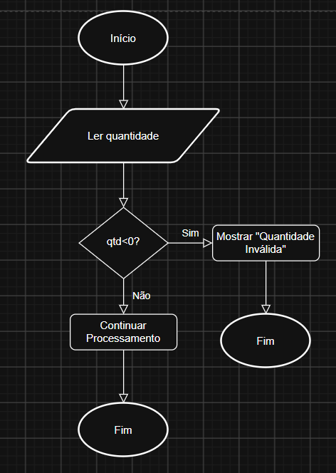
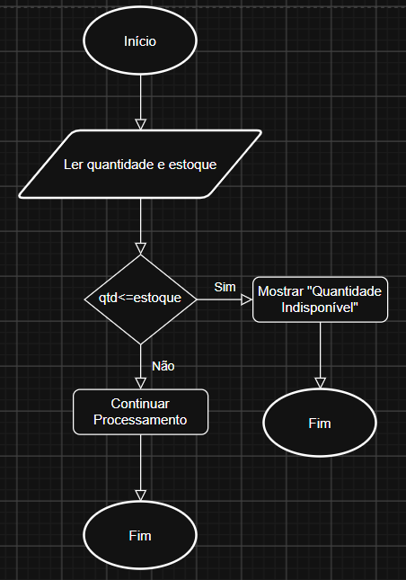
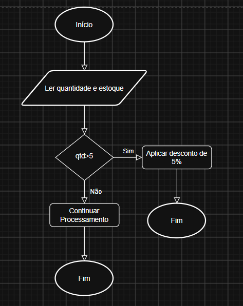
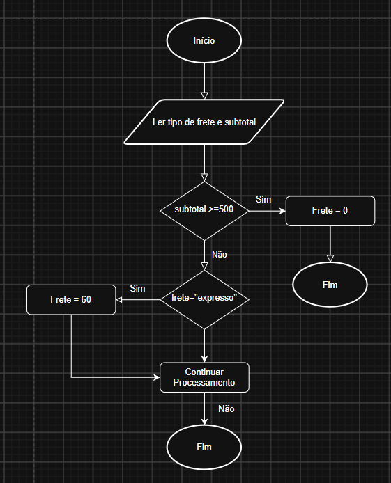
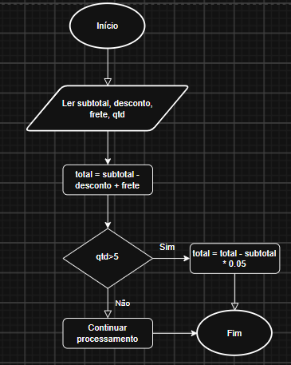
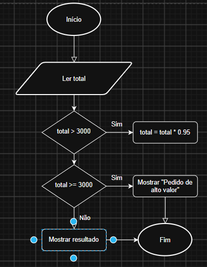

# Atividade Aula 02 - Testes

* **Nome da instituição:** SESI-SENAI
* **Curso:** Desenvolvimento de Sistemas
* **Unidade curricular:** Teste de Software
* **Nome da atividade:** Loja SENAI
* **Nome do aluno:** Nicollas Felisbelo da Silva
* **Turma:** 3º EM B
* **Professor:** Robson e Reenye
* **Data:** 30/09/2026

---

## 1. Contextualização sobre Teste de Caixa Branca

O teste de caixa branca é uma técnica de teste de software que considera a estrutura interna do código durante a análise. Ele permite analisar como o programa está estruturado internamente.

Sua finalidade é verificar se os diferentes caminhos presentes no código estão funcionando como o comportamento esperado. Assim, é possível identificar problemas relacionados a diversos tipos de situações que poderiam não ser percebidos observando apenas o resultado final do programa.

---
## 2. Análise das Estruturas de Decisão

Ao analisar o código da Loja SENAI, foi possível encontrar várias estruturas que mudam o caminho que o programa segue. As principais são os **if**, **else if** e **else**, além dos operadores como **>**, **<** e **>=**.

### 2.1 Quantidade de produto na hora da compra
O primeiro erro está na validação da quantidade que o usuário informa.

No código, a condição utilizada é: se a quantidade for menor que zero a quantidade é inválida. O correto seria considerar o zero como uma quantidade inválida também:

Dificuldade do erro: Fácil

---

### 2.2 Calcular estoque

O segundo erro está na verificação do estoque.

O código possui a seguinte condição de que se a quantidade for maior ou **igual** ao estoque a compra naquela quantidade é inválida.

Dificuldade: Fácil

---

### 2.3 Validação do desconto por quantidade

O terceiro erro é sobre o desconto para compras com uma determinada quantidade de produtos.

A condição utilizada é quantidade maior que 5. Então o desconto só é aplicado quando a quantidade é maior que 5. Caso a regra seja aplicar o desconto para 5 ou mais unidades, a condição deveria ser quando a quantidade for maior ou igual a 5.

Dificuldade do erro: Médio

---

### 2.4 Frete expresso

O quarto erro está no cálculo do frete.

O código verifica primeiro se o tipo de frete escolhido é expresso e só depois verifica se o pedido possui direito ao frete grátis:

Dificuldade do erro: Médio

---

### 2.5 Cálculo do desconto por quantidade

O quinto erro está relacionado ao cálculo do desconto de 5% por quantidade.

Primeiro, o programa calcula o total. Depois, quando a quantidade permite aplicar o desconto, ele calcula de forma errada, calculando 5% do subtotal.

Isso pode fazer com que o resultado final seja diferente do esperado para um desconto de 5% sobre o pedido.

Dificuldade do erro: Difícil

---

### 2.6 Desconto de valor alto

O sexto erro está relacionado ao desconto aplicado em pedidos de alto valor.

O código utiliza, caso o total seja maior que R$ 3000,00. Porém, em outra parte do código, o pedido é considerado de alto valor quando o pedido é maior que R$ 3000,00. Se o desconto se aplica a pedidos de alto valor o certo seria utilizar maior ou igual a R$ 3000,00

Dificuldade do erro: Alta

---

## 3. Fluxogramas dos Testes
|Erro|Fluxograma|
|:-:|:-:|
|1||
|2||
|3||
|4||
|5||
|6||

---
## 4. Casos de Teste

Depois de analisar as condições do código, foram definidos casos de teste para verificar cada um dos erros encontrados.

|Identificação|Entrada|Condição/Caminho| Resultado Esperado|
|:-:|:-:|:-:|:-:|
|CT01| Quantidade **0**|Validação da quantidade|Informar que a quantidade é inválida|
|CT02|Notebook, quantidade **5**|Verificação do estoque|Permitir a compra das 5 unidades|
|CT03|Quantidade **5**|Desconto por quantidade|Aplicar o desconto de 5%|
|CT04|Subtotal ≥ R$ 500,00 e frete expresso|Cálculo do frete        | Aplicar o frete grátis de acordo com a regra |
|CT05|Quantidade superior a **5**|Cálculo do desconto|Calcular corretamente os 5%|
|CT06|Total de **R$ 3.000,00**|Desconto de alto valor|Aplicar o desconto de 5%|

---

## 5. Resultados dos Testes

Depois de executar os testes no código original, os resultados encontrados foram diferentes do que era esperado.

|Teste|Entrada|Resultado Esperado|Resultado Obtido|Situação|
|:-:|:-:|:-:|:-:|:-:|
|CT01|Quantidade **0**|Quantidade inválida|O sistema continua o processamento|Reprovado|
|CT02|Notebook, quantidade **5**|Compra permitida|O sistema considera a quantidade indisponível|Reprovado|
|CT03|Quantidade **5**|Aplicar desconto|O desconto não é aplicado|Reprovado|
|CT04|Subtotal ≥ R$ 500,00 e frete expresso| Frete grátis|Frete de R$ 60,00|Reprovado|
|CT05|Quantidade superior a **5**|Desconto calculado corretamente|O desconto é calculado utilizando o subtotal|Reprovado|
|CT06|Total de R$ 3.000,00|Aplicar desconto de 5%|O desconto não é aplicado|Reprovado|

Os resultados confirmaram os problemas encontrados durante a análise do código.

---

## 6. Análise dos Resultados

Os resultados dos testes mostraram que os seis erros encontrados realmente interferem no funcionamento do sistema.

No **CT01**, foi possível perceber que o valor **0** não era tratado como uma quantidade inválida. Isso acontece porque a condição utilizada verifica apenas valores menores que zero.

No **CT02**, o problema acontece porque o operador **>=** considera que uma quantidade igual ao estoque já é uma quantidade indisponível. Dessa forma, o cliente não consegue comprar todas as unidades disponíveis.

No **CT03**, o desconto por quantidade não é aplicado quando o cliente compra exatamente 5 unidades. Isso ocorre porque a condição exige uma quantidade maior que 5.

No **CT04**, o frete expresso possui prioridade sobre a condição de frete grátis. Dessa forma, o sistema retorna o valor de R$ 60,00 antes de verificar se o pedido possui direito ao frete grátis.

No **CT05**, o desconto de quantidade é calculado sobre o subtotal. Como o total já considera outros valores, como descontos e frete, o cálculo pode apresentar um resultado diferente do esperado.

No **CT06**, foi encontrada uma diferença entre as condições utilizadas para aplicar o desconto e para classificar o pedido como de alto valor. O sistema considera R$ 3.000,00 como um pedido de alto valor, mas não aplica o desconto nesse mesmo valor.

Depois da identificação dos problemas, foram feitas as alterações necessárias no código da pasta **Corrigido**. Os mesmos testes podem ser utilizados novamente nessa versão para verificar se os erros foram solucionados.

---

## 7. Conclusão

Essa atividade possibilita analisar o funcionamento interno de um sistema utilizando conceitos de teste de caixa branca.

Por meio da análise das estruturas condicionais, é possível identificar erros de lógica relacionados a diferentes fatores.

A atividade mostrou a importância do teste de caixa branca para analisar as estruturas internas de um software e verificar se os diferentes caminhos de execução estão produzindo comportamentos esperados.
